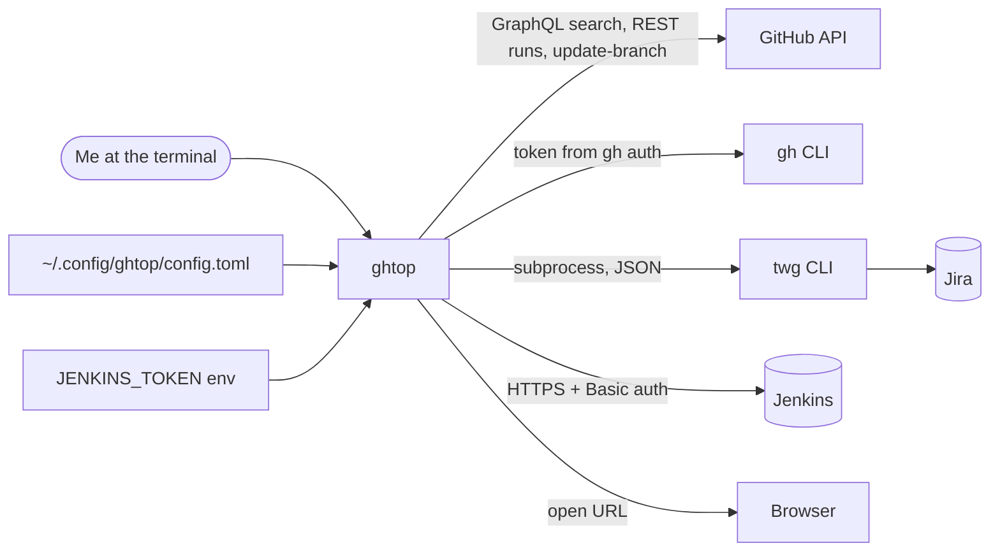
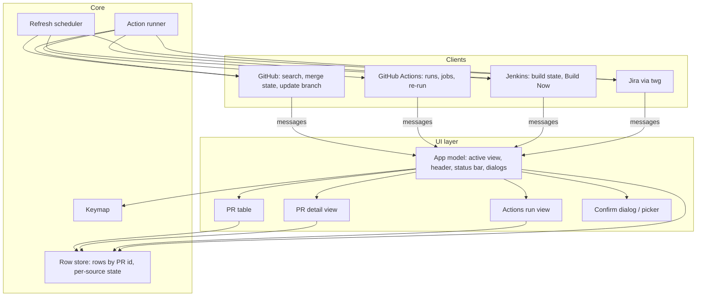
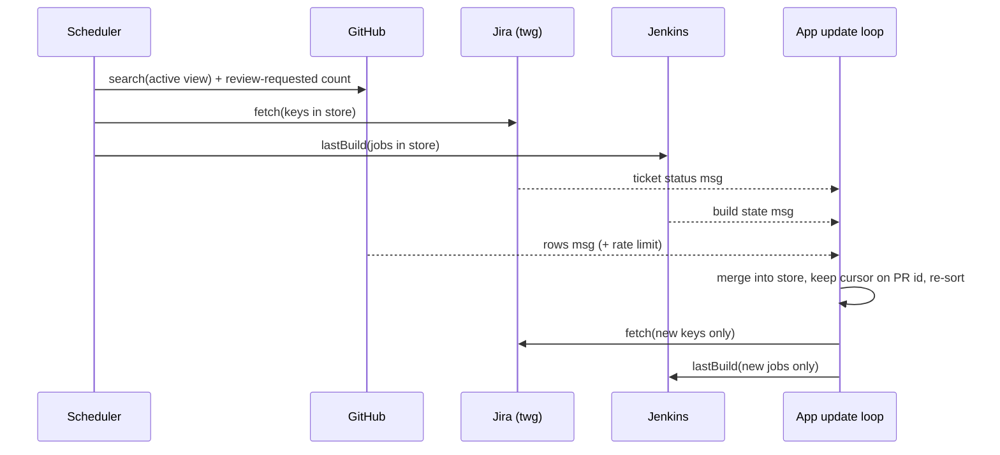

# ghtop architecture

*   **Status:** Reviewed 2026-11-09; kept in step with the code
*   **Date:** 2026-11-08
*   **Design doc:** [designs/ghtop.md](./designs/ghtop.md) (goals, scope,
    user journeys). This file holds the technical plan and the diagrams.
    Update it in the same change as the code it describes.

## Stack

Go with Bubble Tea (terminal UI framework using a model-update-view loop),
Lip Gloss (styling) and Bubbles (list, table, viewport, text input widgets),
latest major versions. gh-dash uses the same stack and is a source of ideas
only. Runs on macOS and Linux.

## System context

## Components

*   **UI layer** draws only from the row store and never calls a client.
    Every fetch or action runs in the background and returns its result as a
    message to the app's update loop. This is the main guard against the
    first attempt's bugs: no result can change the screen except through the
    single update function, so a refresh cannot steal focus or move the cursor.
*   **Row store** holds rows per view, keyed by PR id (`owner/repo#N`);
    each result message carries its view id and goes only into that view's
    cache. It also holds, for each source (GitHub, Jira, Jenkins, Actions),
    its last success time, last error and an available flag. The cursor
    stores the PR id, not a row index, so a re-sort keeps it on the same PR;
    if that PR leaves the view, the cursor keeps the same row index, clamped
    to the last row (empty view: no selection).
*   **Refresh scheduler** runs one timer (5 minutes) and the `r` key. On each
    tick it starts the GitHub search for the active view and the
    Review-requested count, and in parallel the Jira and Jenkins refresh for
    the keys and jobs already in the store. Each source's result arrives and
    is merged on its own. "In flight" is tracked per (source, view): a fetch
    is not started twice for the same view, a view switch starts the new
    view's fetch at once, and leaving a view does not cancel its fetch. Only
    quit cancels running calls.
*   **Action runner** builds the confirm dialog text from the target captured
    at key press, runs the client call after OK, writes one audit line to
    the debug log, and reports the result in the status bar. One action per
    target at a time.
*   **Clients** are concrete Go types with domain-level methods; callers
    never see `gh`/`twg` arguments or output. No interfaces until a second
    implementation exists; `proc.Runner` is the one interface (tests use a
    fake).
    *   `github.Client`: `Search(view) -> rows, rateLimit{remaining, resetAt}, warnings`,
        `ReviewRequestedCount()`, `BehindBy(rows)`, `UpdateBranch(pr)`.
    *   `actions.Client`: `Runs(pr)`, `Jobs(run)`, `RerunFailed(run)`.
    *   `jenkins.Client`: `LastBuild(job)`, `BuildNow(job)`;
        `jenkins.Match(checkURL) -> job` is a plain function.
    *   `jira.Client`: `Fetch(keys)`, `Transitions(key)`, `Move(key,
        quickMove)`, `URL(key)`; `jira.Keys(row)` is a plain function.
    *   `proc.Runner`: `Run(ctx, name, args) -> stdout, stderr, exit code`
        for `gh` and `twg`; `Start(name, args) -> error` for the detached
        browser opener (output discarded, outside the process cap). The only
        code that starts processes.
    Views read availability flags (for example "Jira available"), never
    client names.

## Data model (summary)

Field detail is written at M1 (see implementation.md).

*   **Row**: PR id, repo, number, title (as written; optional
    leading-key strip from config), URL, state (open, draft,
    merged, closed), base and head branch, merge state (clean, behind,
    conflicts, unknown), behind-by count, last commit time, updated time,
    roles (author, review-requested, involved), reviews (approved, changes
    requested, unresolved threads, unanswered threads, unanswered comment),
    checks, ticket keys (primary first), ticket status.
*   **Check**: name, kind (Actions, Jenkins, other), state, URL; for Jenkins
    the parsed job URL and build number; for Actions the run id once fetched.
*   **CI state order** (worst first): failure, unstable, running, aborted,
    unknown, success. A row's CI summary is the worst state plus counts.
*   **Source state**: available, last ok time, last error class and message,
    stale flag.

## Data flow: one refresh

When the GitHub result brings keys or jobs not seen before, the app starts a
second, smaller Jira and Jenkins fetch for just those.

## GitHub access

The GitHub search and merge-state queries follow pr-tracker's proven shape:
one search per view with caps and a warning when a cap is hit; a lighter query
for closed PRs (the full one hit GitHub's 10 s limit). Behind-by is one REST
compare per open PR (`behind_by`), run after each Open, Involved or
Review-requested search for the active view's open PRs only (never Merged),
through the process cap; conflicts come from `mergeStateStatus`. Every
GraphQL call reads `rateLimit { cost remaining resetAt }`; the header shows
the remaining budget. Compare calls use the separate REST core quota
(5000/hour); at a 5 min refresh this is far below the limit, so it is not
shown in the header. There is no budget floor or cap: one view every 5
minutes stays far below the hourly limit.

How ghtop calls GitHub: `gh` subprocess behind concrete clients; see
[concepts_brief.md, "GitHub access"](./plan/concepts_brief.md#github-access).

## Jira access

Subprocess calls to `twg` with JSON output, as pr-tracker does: one query for
all keys (`key in (...)`), transitions listed read-only, a quick move runs only
when exactly one transition matches. Keys are validated against the
configured pattern before they reach JQL or command arguments.

## Jenkins access

Plain HTTPS with Basic auth, at most 4 requests at once and a 10 s timeout
(`JENKINS_USER` from config or env,
`JENKINS_TOKEN` from env only). A check URL counts as Jenkins only when it
parses as `https`, its host exactly matches a configured host, and its path
matches the configured job pattern; the API URL is rebuilt from those parts,
never taken raw. State is read from `<job>/lastBuild/api/json`. Build Now
posts to `buildWithParameters` with no parameters, so the job uses its
defaults (`<job>/build` for a job without parameters), parses only the queue
item id from the `Location` header, and checks
`https://<job's configured host>/queue/item/<id>/api/json` at 10 s and 20 s
(the `Location` URL itself is never polled; with no id, ghtop reports
"queued" and does not poll); after that the normal refresh picks the build
up. A 403 without an `x-jenkins`
header means "blocked before Jenkins" (VPN); a 404 is ignored and the GitHub
check state is kept. No crumb handling: API-token requests do not need one.

## Errors and source health

Three errors get a fix hint: auth expired (`gh auth login` or
`twg login --force`), "VPN off?" (Jenkins 403 without `x-jenkins`) and rate
limited (with reset time). Any other error shows its last stderr line or HTTP
status. A failed source keeps its last values with a stale mark; a cap hit is
a warning in the status bar. A `gh api graphql` call that exits non-zero but
returns `data` with `errors` (partial result) is not a failure: the rows are
shown and the `errors` messages are a status-bar warning; only a response
without `data` fails the fetch. Errors never open a dialog during a refresh; only
a failed action shows its error in the status bar. Availability is checked at
start and on `r`. `--debug` writes a log to the user state directory with
command names, paths, durations and status codes, never headers or bodies.

## Config

TOML at `~/.config/ghtop/config.toml`, or the path given with `--config`.
Unknown keys stop ghtop with the path and the key. ghtop never writes the
config. Holds: org (required), view day windows, Jira site, key pattern (Go
regex, matched case-insensitively), ticket status order and quick moves,
Jenkins hosts and job pattern, poll interval, UI options. Secrets only from
the environment. The repo ships a placeholder example.

## GitHub access decision

ghtop calls the `gh` CLI as a subprocess, behind concrete clients with
domain-level methods (`github.Client`, `actions.Client`), so a later switch to
`go-gh` rewrites `internal/github` and `internal/actions` only. Every command
comes from a closed list in `services/github.md`. Rules and consequences:
[concepts_brief.md, "GitHub access"](./plan/concepts_brief.md#github-access).
