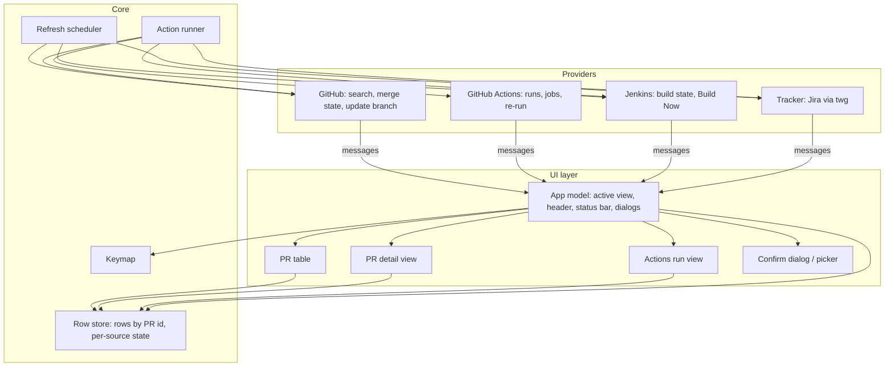
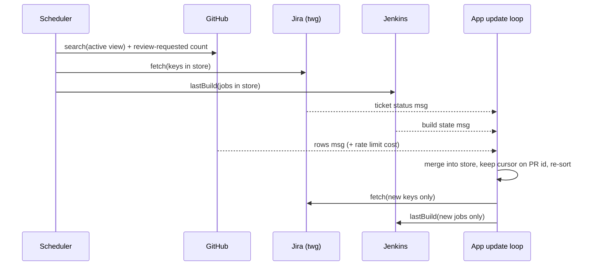

# ghtop architecture

*   **Status:** Draft
*   **Date:** 2026-11-08
*   **Design doc:** [designs/ghtop.md](./designs/ghtop.md) (goals, scope,
    user journeys). This file holds the technical plan and the diagrams.
    Update it in the same change as the code it describes.

## Stack

Go with Bubble Tea (terminal UI framework using a model-update-view loop),
Lip Gloss (styling) and Bubbles (list, table, viewport, text input widgets).
This is the stack gh-dash uses, so its code is a working reference for focus,
resize and keymap handling.

## System context

## Components

*   **UI layer** draws only from the row store and never calls a provider.
    Every fetch or action runs in the background and returns its result as a
    message to the app's update loop. This is the main guard against the
    first attempt's bugs: no result can change the screen except through the
    single update function, so a refresh cannot steal focus or move the cursor.
*   **Row store** holds rows keyed by PR id (`owner/repo#N`), plus, for each
    source (GitHub, Jira, Jenkins, Actions), its last success time, last error
    and an available flag. The cursor stores the PR id, not a row index, so a
    re-sort keeps it on the same PR.
*   **Refresh scheduler** runs one timer (5 minutes) and the `r` key. On each
    tick it starts the GitHub search for the active view and the
    Review-requested count, and in parallel the Jira and Jenkins refresh for
    the keys and jobs already in the store. Each source's result arrives and
    is merged on its own. A source already in flight is not started twice.
*   **Action runner** builds the confirm dialog text from the target captured
    at key press, runs the provider call after OK, writes one audit line to
    the debug log, and reports the result in the status bar. One action per
    target at a time.
*   **Providers** are small Go interfaces, one implementation each:
    *   `PRSource`: `Search(view) -> rows, cost, warnings`;
        `ReviewRequestedCount()`; `UpdateBranch(pr)`.
    *   `ActionsProvider`: `Runs(pr)`, `Jobs(run)`, `RerunFailed(run)`.
    *   `CIProvider` (Jenkins): `Match(check) -> job`, `LastBuild(job)`,
        `BuildNow(job, preset)`.
    *   `Tracker` (Jira): `Keys(pr)`, `Fetch(keys)`, `Transitions(key)`,
        `Move(key, quickMove)`, `URL(key)`.
    Views read capability flags (for example "tracker available"), never
    provider names.

## Data model (summary)

Full field list goes in `core/data-model.md`.

*   **Row**: PR id, repo, number, title (as written; optional
    leading-key strip from config), URL, state (open, draft,
    merged, closed), base and head branch, merge state (clean, behind,
    conflicts, unknown), behind-by count, last commit time, updated time,
    roles (author, review-requested, involved), reviews (approved, changes
    requested, unresolved threads, unanswered threads, unanswered comment),
    checks, ticket keys (primary first), ticket status.
*   **Check**: name, kind (Actions, Jenkins, other), state, URL; for Jenkins
    the parsed job URL and build number; for Actions the run id once fetched.
*   **CI state order** (worst first): failure, unstable, running, aborted,
    unknown, success. A row's CI summary is the worst state plus counts.
*   **Source state**: available, last ok time, last error class and message,
    stale flag.

## Data flow: one refresh

When the GitHub result brings keys or jobs not seen before, the app starts a
second, smaller Jira and Jenkins fetch for just those.

## GitHub access

The GitHub search and merge-state queries follow pr-tracker's proven shape:
one search per view with caps and a warning when a cap is hit; a lighter query
for closed PRs (the full one hit GitHub's 10 s limit); one aliased query for
behind-by counts. Every GraphQL call reads `rateLimit { cost remaining
resetAt }`; the header shows the remaining budget and ghtop skips a scheduled
poll (not a manual one) when the remaining budget is below a floor.

How ghtop calls GitHub: `gh` subprocess behind interfaces; see
[0009-github-access.md](./decisions/0009-github-access.md).

## Jira access

Subprocess calls to `twg` with JSON output, as pr-tracker does: one query for
all keys (`key in (...)`), transitions listed read-only, a quick move runs only
when exactly one transition matches. Keys are validated against the
configured pattern before they reach JQL or command arguments.

## Jenkins access

Plain HTTPS with Basic auth (`JENKINS_USER` from config or env,
`JENKINS_TOKEN` from env only). A check URL counts as Jenkins only when it
parses as `https`, its host exactly matches a configured host, and its path
matches the configured job pattern; the API URL is rebuilt from those parts,
never taken raw. State is read from `<job>/lastBuild/api/json`. Build Now
posts to `<job>/build` (or `buildWithParameters` with a preset), reads the
queue item from the `Location` header, and polls it until it has a build
number (bounded number of tries). A 403 without an `x-jenkins` header means
"blocked before Jenkins" (VPN); a 404 is ignored and the GitHub check state is
kept; a crumb error triggers one crumb fetch and one retry.

## Errors and source health

Every provider error is mapped to a class: tool missing, auth expired,
network blocked, rate limited, upstream timeout, not found, truncated, config
invalid, action rejected. The class decides the header text, the fix hint,
whether the next poll retries, and whether cells get a stale mark. Errors never
open a dialog during a refresh; only a failed action shows its error in the
status bar. `ghtop doctor` runs the same availability checks as start-up and
prints them; `--debug` writes a log (tokens and auth headers removed) to the
user state directory.

## Config

TOML at `~/.config/ghtop/config.toml` (honours `$XDG_CONFIG_HOME`; `GHTOP_CONFIG`
or `--config` override). Has a `version` field; an unknown version or the old
attempt's schema stops ghtop with the path and a hint. ghtop never writes the
config. Holds: org, views (merged and involved day windows), Jira site and key
pattern (Go regex, matched case-insensitively), quick moves, Jenkins hosts, job
pattern, parameter presets, poll interval, budget floor. Secrets only from the
environment. The repo ships a placeholder example.

## GitHub access decision

ghtop calls the `gh` CLI as a subprocess, behind domain interfaces
(`PRSource`, `ActionsProvider`) so the implementation can be swapped later.
Every command comes from a closed list in `services/github.md`. Rules and
consequences: [0009-github-access.md](./decisions/0009-github-access.md).
