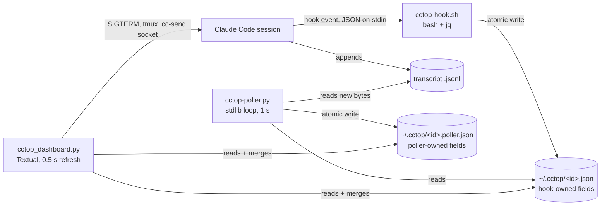

# Python alternative: how cctop is built

*   **Status:** Reference
*   **Date:** 2026-11-08
*   **Source read:** [DeanLa/cctop](https://github.com/DeanLa/cctop) at
    `6ec6256` (plugin version 0.6.0), cloned at `~/github/cctop`.
*   **Related:** [architecture.md](./architecture.md) (Go plan),
    [ghtop-python-mvp.md](./ghtop-python-mvp.md) (Python MVP plan, which already
    names cctop as its reference).

cctop is an htop-style terminal dashboard for Claude Code sessions, written in
Python with Textual. It is the closest working example of what a Python ghtop
would look like, so this file records how it is put together, what is worth
copying and what is not.

## Shape: three programs and a folder of JSON files

cctop is not one program. It is three, joined by files in `~/.cctop/`:

| Part | File | Size | Runs as |
| --- | --- | --- | --- |
| Hook | `plugin/scripts/cctop-hook.sh` | ~300 lines | Claude Code hook, once per event, for 22 events (`plugin/hooks/hooks.json`) |
| Poller | `plugin/scripts/cctop-poller.py` | 768 lines | Background loop started by the launcher |
| Dashboard | `plugin/scripts/cctop_dashboard.py` | 2818 lines | Foreground Textual app |
| Peer messaging | `plugin/scripts/cc-send` | 142 lines | CLI, used by the dashboard for rename |
| Launcher | `plugin/scripts/launch-cctop.sh`, `bin/cctop` | small | Starts poller in background, dashboard in foreground, kills poller on exit |

The key rule: **each file has exactly one writer.** The hook writes
`<id>.json`, the poller writes `<id>.poller.json`, the dashboard writes
neither. Both writers use temp file plus rename. That removes every write race
without locks. The dashboard merges the two dicts into one `SessionInfo`
(`_build_session_info`), with a few fields "poller first, hook as fallback".

## Hook (bash + jq)

*   Reads stdin once, extracts all fields with a single `jq @sh` call, then
    `eval`s them. Goal is under 50 ms per event. Exits silently if `jq` is
    missing.
*   A `case` on the event name is the status state machine: `UserPromptSubmit`
    -> `thinking`, `PreToolUse` -> `tool:<Name>`, `Stop` -> `idle` (or
    `idle:awaiting_plan` / `idle:needs_input` based on the last tool),
    `Notification` -> `awaiting_permission` etc. Unknown events are heartbeats:
    keep status, refresh `last_activity`.
*   Counters (`tool_count`, `running_agents`, `tool_failures`) are updated
    inside the final `jq` merge, so the read-modify-write is one expression.
*   Lifecycle events go into a `hook_events` ring buffer capped at 100.
*   `SessionEnd` deletes both files.

## Poller (stdlib only)

*   Loop every 1 s over `~/.cctop/*.json`. For each session it seeks to the
    stored byte offset in the transcript and parses only new lines
    (`read_new_jsonl_lines`). It also stores the file's inode: a changed inode
    (compaction rewrites the file) or a shrunk file resets the offset to 0.
*   `parse_new_lines` returns plain values plus `_delta_*` keys;
    `_accumulate_deltas` adds deltas to running totals (turns, tokens, tool
    count, files edited, events). Offsets and inode live in the same poller file
    under `_poller_*` keys.
*   Extra derived data: subagent token totals (per-subagent offsets), git branch
    and worktree detection when `cwd` changes.
*   Every 30 s, `cleanup_dead_sessions` removes files whose PID is dead (with a
    180 s grace period for sessions still starting) or that are stale for an
    hour.

## Dashboard (Textual)

One `App` subclass, `SessionsDashboard`, plus small `ModalScreen` classes
(column picker, group picker, kill confirm, rename, untracked-process details,
help) and a `DataTable` subclass `_CctopTable` that overrides cursor movement
and highlight rendering.

**Refresh loop.** `set_interval(0.5, _schedule_refresh)` starts
`_do_refresh`, which is `@work(thread=True, exclusive=True)`: it reads all
JSON files in a thread and hands the result back with
`call_from_thread(self._apply_refresh, ...)`. `exclusive=True` cancels a
refresh still running when the next starts, so there is never more than one.
Every 10 s the same worker also runs `ps` to find Claude processes that have no
status file (shown in a health bar).

**Table updates keep the cursor.** `_repopulate_table` builds `(row_key,
cells)` for the current sort, filter and grouping. If the list of row keys is
unchanged it patches cells with `update_cell` (no flicker, no cursor move).
Otherwise it saves the cursor's row key, clears, re-adds rows, and moves the
cursor back to that key. Row keys are session ids.

**Table-driven columns.** `COLUMNS` is a tuple of frozen `ColumnDef`
dataclasses: key, header, `cell(session)` renderer, optional `sort_key`,
`reverse_sort`, `filterable`. Sorting, the text filter, hide/show, and the
column picker are all generic over this tuple. Grouping uses the same idea
(`GroupDef` with a `group_fn`). Status colors and labels come from one dict,
`STATUS_STYLE_MAP`.

**State and config.** View state (sort column, reverse, group-by) is Textual
`reactive` attributes; their `watch_*` methods re-render and persist.
`~/.cctop/config.toml` is read with `tomllib`, deep-merged over
`_CONFIG_DEFAULTS`, and written back by a small hand-written TOML serializer
(no dependency). Any user-settable state must go through this config (a rule
in the repo's `CLAUDE.md`).

**Actions.** Kill sends `SIGTERM` to the session PID after a confirm modal, in
a worker; result shown with `notify`. Attach switches tmux to the session's
pane. Rename shells out to `cc-send`, which talks to Claude Code's per-session
Unix socket, and applies the new name optimistically until the poller catches
up. Bindings that make no sense for the selected row are disabled with
`check_action`.

**Detail panels.** Selecting a row fills a chat panel, an info panel and an
optional activity feed (Rich `Group`/`Table`/`Markdown` rendered into
`Static` widgets inside `VerticalScroll`).

## Packaging and tests

*   Each script carries PEP 723 inline metadata (`requires-python >=3.11`,
    dashboard depends on `textual>=3.0.0`, poller has no deps) and runs with
    `uv run --script`. No `pyproject.toml`, no virtualenv to manage.
*   Shipped as a Claude Code plugin from a local marketplace
    (`.claude-plugin/marketplace.json` -> `plugin/`). `bin/cctop` finds the
    installed copy in `~/.claude/plugins/cache/`.
*   `pytest` with ~200 dashboard tests: plain unit tests for formatters and
    parsing, and Textual `App.run_test()` / `pilot` tests for key handling and
    table behaviour (`tests/test_cctop_dashboard.py`). Poller and `cc-send`
    have their own test files.

## What ghtop should take

*   **Background work returns a message; only the UI thread changes the
    screen.** Same rule as [architecture.md](./architecture.md#components).
    In Textual: `@work` plus `call_from_thread`, or an async worker that posts a
    custom `Message`.
*   **`exclusive=True` workers per source** give "a source already in flight is
    not started twice" for free. Use one worker group per source (GitHub, Jira,
    Jenkins) so they do not cancel each other.
*   **Cursor by row key, patch cells when keys are unchanged.** Direct match for
    ghtop's "cursor stores the PR id". Row key = `owner/repo#N`.
*   **Table-driven `ColumnDef`** with renderer, sort key and filter flag.
*   **Single writer per piece of state** and temp-file-plus-rename for any
    file ghtop writes (cache, debug log rotation).
*   **PEP 723 + `uv run --script`** is a fast way to ship an MVP to a few
    people. Move to a package once it splits into modules.
*   **`run_test()` pilot tests** for keymap and focus behaviour; these are the
    tests that would have caught the first attempt's focus-stealing bugs.

## What ghtop should not copy

*   **One 2800-line file.** Fine for a hobby tool, hard to review. ghtop's
    providers, store and views should be separate modules, as in
    [ghtop-python-mvp.md](./ghtop-python-mvp.md).
*   **Re-reading everything every 0.5 s.** Cheap for a few local JSON files.
    ghtop's data is remote and rate limited, so it needs the scheduler, budget
    floor and per-source health from [architecture.md](./architecture.md),
    none of which cctop has.
*   **The producer/consumer process split.** cctop needs it because Claude
    Code pushes data through hooks. ghtop pulls from APIs and can fetch inside
    the app process; no poller daemon, no status folder.
*   **Silent failure.** The hook exits 0 if `jq` is missing and most reads
    swallow errors into `{}`. ghtop's error classes and `doctor` command are
    the better model.
*   **Unbounded growth.** The poller's `recent_events` list grows for the life
    of the session and is rewritten on every change.

## Open points for the ghtop Python MVP

*   [ghtop-python-mvp.md](./ghtop-python-mvp.md) pins `textual>=0.80,<1.0`;
    cctop runs on `textual>=3.0.0`. Pick the newer line before writing code, so
    cctop stays a usable reference.
*   cctop config is TOML under `~/.cctop/`; the Python MVP plan says YAML under
    `~/.config/ghtop/`, while [architecture.md](./architecture.md#config) says
    TOML. Settle on TOML (stdlib `tomllib` reads it).
*   Small nit seen in passing: `_do_kill`'s docstring says SIGINT, the code
    sends SIGTERM.
